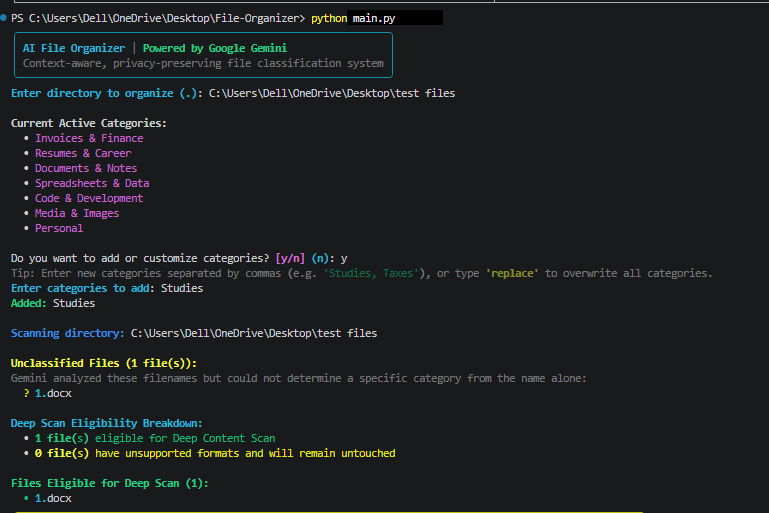
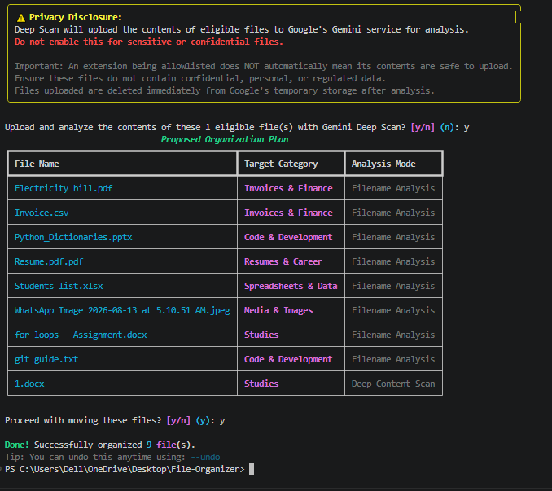

# AI-Powered File Organizer

A privacy-aware command-line tool that uses Google Gemini to sort files into folders you define, based on what a file *is for*, not just its extension. Every run can be previewed with a dry run and reversed with a single undo command.




## Table of Contents

- [Overview](#overview)
- [Problem Statement](#problem-statement)
- [Features](#features)
- [How It Works](#how-it-works)
- [Tech Stack](#tech-stack)
- [Project Structure](#project-structure)
- [Getting Started](#getting-started)
- [Usage](#usage)
- [Testing](#testing)
- [Privacy & Safety](#privacy--safety)
- [Limitations](#limitations)
- [Future Work](#future-work)
- [Author](#author)

## Overview

Traditional organizers map extensions to folders (`.pdf` → Documents). That tells you the *format* of a file, not its *purpose*. `Electricity_bill.pdf` and `Python_Operators.pdf` are both PDFs, but they belong in very different places.

This tool sends each filename to Gemini together with your list of categories, and Gemini picks the single best folder, or says `Unknown` when the name carries no real meaning. Files that stay unknown can optionally go through a deeper content scan, but only after you explicitly agree.

The project started as a single-file script and was refactored into a modular package with a proper CLI, retry/fallback logic, dry-run mode and undo support.

## Problem Statement

Folders like Downloads fill up with assignments, bills, slides, spreadsheets, images and personal documents. Rule-based sorting cannot tell them apart when they share an extension, and sending every file's contents to an AI service is a privacy risk. The goal: **context-aware sorting that is flexible, reversible, and private by default.**

## Features

- **Context-aware classification**: Gemini decides based on filename and extension, within *your* categories.
- **Custom or default categories**: pass them via CLI, enter them interactively, or use the built-in defaults. Categories are saved to `ai_categories.json`.
- **Unknown handling**: generic names like `1.pdf`, `scan.pdf` or `untitled.docx` are returned as `Unknown` rather than guessed.
- **Opt-in deep content scan**: unknown files with a supported extension can be uploaded to Gemini for content-based classification, after a privacy disclosure and explicit consent. The uploaded file is deleted afterwards (best effort).
- **Dry run**: `--dry-run` shows the planned moves in a table without touching your files.
- **Undo**: `--undo` rolls back the last organization session using a transaction log (`organization_history.json`).
- **Confirmation before moving**: you review the plan table and approve it first.
- **Resilient API handling**: retries, automatic fallback across multiple Gemini models, and a clear distinction between *API failures* (503 / 429 / network) and genuine *Unknown* classifications.
- **Concurrent classification**: filenames are classified in parallel with a thread pool.
- **Rich terminal UI**: tables, panels and status spinners via [Rich](https://github.com/Textualize/rich).
- **Testable design**: the Gemini client can be injected into `OrganizerEngine`, so the logic can be tested without real API calls.

## How It Works

```
Scan directory (top-level files only)
        ↓
Filename + extension + your categories → Gemini
        ↓
   ┌────────────┬───────────────┬─────────────┐
 Category     Unknown        API error
   ↓            ↓               ↓
 Planned     Eligible for     Reported,
  move       deep scan?       file untouched
                ↓
     Privacy disclosure + consent
                ↓
       Content scan via Gemini
                ↓
   Plan table → confirm → move files → record history (for undo)
```

**Result types from the classifier**

| Result | Meaning |
|---|---|
| Category name | Confident match, added to the plan |
| `Unknown` | Name was generic or no category fit; candidate for deep scan |
| `API_ERROR` | Request failed after retries and fallbacks; file left untouched |

## Tech Stack

- **Language:** Python 3
- **AI:** Google Gemini via the `google-genai` SDK
- **Terminal UI:** `rich`
- **Config:** `python-dotenv` (`.env` for the API key)
- **Standard library:** `os`, `shutil`, `json`, `argparse`, `concurrent.futures`
- **Tools:** Git, GitHub, VS Code

## Project Structure

```
File-Organizer/
├── main.py                 # Entry point
├── src/
│   └── file_organizer/
│       ├── __init__.py     # Package exports
│       ├── cli.py          # Argument parsing, prompts, Rich output
│       ├── config.py       # Models, default categories, prompts, ignore lists
│       ├── core.py         # OrganizerEngine: classification, planning, execution
│       └── history.py      # HistoryManager: session log and undo
├── tests/
│   ├── test_core.py        # Engine tests
│   └── test_history.py     # History / undo tests
├── docs/                   # Screenshots used in this README
├── .github/workflows/
│   └── ci.yml              # CI workflow
├── requirements.txt
├── .env.example
├── .gitignore
└── README.md
```

## Getting Started

**1. Clone the repository**

```bash
git clone https://github.com/zarakhan3913/File-Organizer.git
cd File-Organizer
```

**2. Install dependencies**

```bash
pip install -r requirements.txt
```

**3. Add your Gemini API key**

Get a key from [Google AI Studio](https://aistudio.google.com/), then copy the example env file and fill it in:

```bash
cp .env.example .env
# edit .env and set GEMINI_API_KEY=your_key_here
```

The key is read from the environment or `.env`. Never commit it.

## Usage

```bash
python main.py
```

| Flag | Description |
|---|---|
| `--path PATH` | Directory to organize (otherwise you are prompted, default `.`) |
| `--dry-run` | Preview the plan without moving anything |
| `--undo` | Roll back the last organization session |
| `--categories "A, B, C"` | Use exactly these categories (replaces saved/default ones) |
| `--add-categories "X, Y"` | Add categories to the existing list |
| `--deep-scan` | Skip the deep-scan consent prompt (the privacy disclosure is still shown) |

**Examples**

```bash
# Preview what would happen in Downloads
python main.py --path ~/Downloads --dry-run

# Organize with your own categories
python main.py --path ~/Downloads --categories "University, Projects, Finance, Personal"

# Changed your mind
python main.py --undo
```

Default categories: `Invoices & Finance`, `Resumes & Career`, `Documents & Notes`, `Spreadsheets & Data`, `Code & Development`, `Media & Images`.

## Testing

The test suite uses `pytest` and a mocked Gemini client, so it runs offline and needs no API key.

```bash
python -m pytest -v
```

**What is covered (8 tests)**

- File eligibility rules (what gets ignored)
- Filename classification with a mocked Gemini response
- Responses outside the category list are treated as `Unknown`
- Plan generation and dry-run execution
- API failures are reported separately from `Unknown`
- Plan table rendering
- History recording and undo, plus undo with empty history

Tests also run automatically on every push and pull request via GitHub Actions (Python 3.10, 3.11, 3.12).

## Privacy & Safety

- **Filename-only by default.** Only the file name, extension and your category list are sent to Gemini during normal classification.
- **Deep scan is opt-in.** File contents are uploaded only after a disclosure and your confirmation, and only for supported extensions. A supported extension does *not* mean a file is safe to upload, so avoid sensitive or confidential files.
- **No overwriting.** If a file with the same name already exists in the destination folder, the move is skipped.
- **Reversible.** Every executed move is logged, so `--undo` can restore files to their original locations.
- **Config and hidden files are ignored** (`.env`, `ai_categories.json`, `organization_history.json`, dotfiles, etc.).
- **API key stays out of the code** and is loaded from the environment.

## Limitations

- Only top-level files in the chosen directory are processed (no recursion).
- Filename-based results are only as good as the filenames; vague names end up as `Unknown`.
- Results depend on Gemini availability and API quota.
- Undo restores the most recent session; run it again to step further back.

## Future Work

- Wider test coverage (deep scan and CLI flows)
- Optional recursive scanning
- Handling of duplicate-name conflicts (rename instead of skip)
- Activity logs and classification confidence scores
- Local/offline model option for sensitive environments
- Packaging with `pyproject.toml` and a `file-organizer` console command

## Author

**Zara Khan**
Computer Science Student | Generative AI Enthusiast

GitHub: [zarakhan3913](https://github.com/zarakhan3913) 